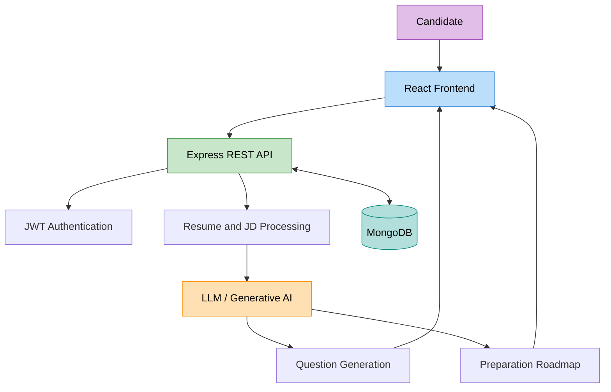

# 🚀 AI Interview Preparation Platform | MERN + GenAI

<p align="center">
  
  
  
</p>

<p align="center">
  An AI-powered interview preparation platform that transforms resumes and job descriptions into personalized interview questions, skill-gap insights, and structured preparation roadmaps.
</p>

<p align="center">
  <b>Prepare smarter. Practice better. Interview with confidence.</b>
</p>

---

## 📌 Overview

The **AI Interview Preparation Platform** helps candidates prepare for technical and behavioral interviews using Generative AI. By analyzing a candidate's resume alongside a target job description, the platform generates relevant interview questions and personalized preparation recommendations.

The project combines the MERN stack with Large Language Models (LLMs) to deliver a practical, personalized, and scalable interview preparation experience.

### ✨ Key Highlights

- 🤖 AI-generated technical and behavioral interview questions
- 📄 Resume and job description analysis
- 🎯 Role-specific interview preparation
- 🗺️ Personalized learning and preparation roadmaps
- 🔐 Secure authentication using JSON Web Tokens (JWT)
- ⚡ RESTful API architecture
- 📱 Responsive and user-friendly interface

---

## 🛠️ Tech Stack

### Frontend
<p>
  
  
  
  
</p>

### Backend
<p>
  
  
  
</p>

### Database & Authentication
<p>
  
  
</p>

### AI & Development Tools
<p>
  
  
  
  
</p>

> Adjust the technology badges to match the libraries, AI provider, and tools actually used in your implementation.

---

## 🌟 Features

### 1. 📄 Resume & Job Description Analysis
- Accept candidate resume information and target job descriptions.
- Identify relevant skills, technologies, and role requirements.
- Use contextual information to personalize the interview preparation experience.

### 2. 🤖 AI-Powered Question Generation
- Generate technical questions based on the target role.
- Create behavioral and situational interview questions.
- Tailor question difficulty and topics to the supplied context.

### 3. 🎯 Personalized Preparation Roadmap
- Organize important topics according to job requirements.
- Highlight potential skill gaps between the candidate profile and the job description.
- Recommend areas to focus on before an interview.

### 4. 🔐 Authentication & Security
- JWT-based authentication.
- Protected endpoints for authenticated users.
- Environment-based configuration for secrets and API keys.

### 5. ⚡ Scalable Backend
- RESTful API endpoints for frontend-backend communication.
- Modular route and controller organization.
- MongoDB integration for persistent application data.

---

## 🏗️ System Architecture



### 🔄 Application Workflow

1. The candidate submits resume details and a target job description.
2. The backend validates the request and processes the input.
3. Contextual prompts are prepared for the selected AI model.
4. The AI generates interview questions and preparation recommendations.
5. The backend formats the response and returns it to the frontend.
6. The candidate reviews the generated questions and preparation roadmap.

---

## ⚙️ Getting Started

### Prerequisites

Install the following before running the project:

- Node.js and npm
- MongoDB or a MongoDB Atlas connection
- Git
- An API key for the LLM provider used by your application

### 1. Clone the Repository

```bash
git clone https://github.com/rohanbyale/ai-interview-preparation.git
cd ai-interview-preparation
```

Replace the repository URL with your actual GitHub repository URL.

### 2. Install Dependencies

If your project uses separate frontend and backend folders:

```bash
cd client
npm install

cd ../server
npm install
```

### 3. Configure Environment Variables

Create a `.env` file in the backend directory.

```env
PORT=5000
MONGODB_URI=your_mongodb_connection_string
JWT_SECRET=your_strong_jwt_secret
AI_API_KEY=your_ai_provider_api_key
```

Replace `AI_API_KEY` with the actual environment variable expected by your AI SDK. Never commit real credentials or secret keys to GitHub.

If the frontend requires a backend URL, configure its environment variable according to the frontend framework.

### 4. Run the Backend

```bash
cd server
npm run dev
```

If your project uses a different development script, use the command defined in its `package.json`.

### 5. Run the Frontend

Open another terminal:

```bash
cd client
npm run dev
```

Open the local URL printed by your frontend development server.

---


## 🧠 AI Implementation

The AI layer is designed around contextual prompt engineering.

### Core Concepts

- **Context extraction:** Use relevant information from the resume and job description.
- **Prompt engineering:** Provide clear instructions, role context, and expected output structure.
- **Structured generation:** Request organized questions and preparation recommendations.
- **Response validation:** Validate generated content before presenting it to the user.
- **Error handling:** Handle timeouts, rate limits, invalid responses, and provider errors.

### Example Prompt

```text
You are an experienced technical interviewer.

Analyze the candidate profile and job description below.

Generate:
1. Technical interview questions
2. Behavioral interview questions
3. Questions grouped by topic and difficulty
4. A personalized preparation roadmap

Candidate Profile:
{resumeText}

Job Description:
{jobDescription}

Return the response in a clear, structured format.
```

---

## 🔒 Security Considerations

- Store secrets in environment variables.
- Hash passwords using a suitable password-hashing algorithm.
- Verify JWTs on protected routes.
- Validate and sanitize incoming request data.
- Apply rate limiting to authentication and AI generation endpoints.
- Avoid logging sensitive resume information or credentials.
- Limit uploaded file types and sizes if resume uploads are supported.

---

## 📈 Performance & Evaluation

Evaluate the platform using measurable criteria:

- **Question relevance:** How closely generated questions match the resume and job description.
- **Response latency:** Time taken to return AI-generated results.
- **Roadmap usefulness:** Whether recommendations address actual role requirements.
- **API reliability:** Success rate, error rate, and handling of provider failures.
- **User experience:** Ease of use, responsiveness, and clarity of results.

Only publish numerical performance claims after testing them with a documented evaluation method and representative dataset.

---

## 🚧 Future Enhancements

- 🎤 AI-powered mock interview sessions
- 🗣️ Voice-based interview practice
- 📊 Answer evaluation and feedback
- 📚 Topic-wise coding challenges
- 📅 Interview preparation progress tracking
- 📄 PDF resume upload and parsing
- 📈 Skill-gap analytics dashboard
- 🌐 Deployment with automated CI/CD

---

## 🤝 Contributing

Contributions, suggestions, and bug reports are welcome.

1. Fork the repository.
2. Create a feature branch.
3. Make your changes.
4. Test your implementation.
5. Submit a pull request describing the changes.

---


<p align="center">
  <b>Built to make interview preparation smarter with MERN and Generative AI.</b>
</p>
